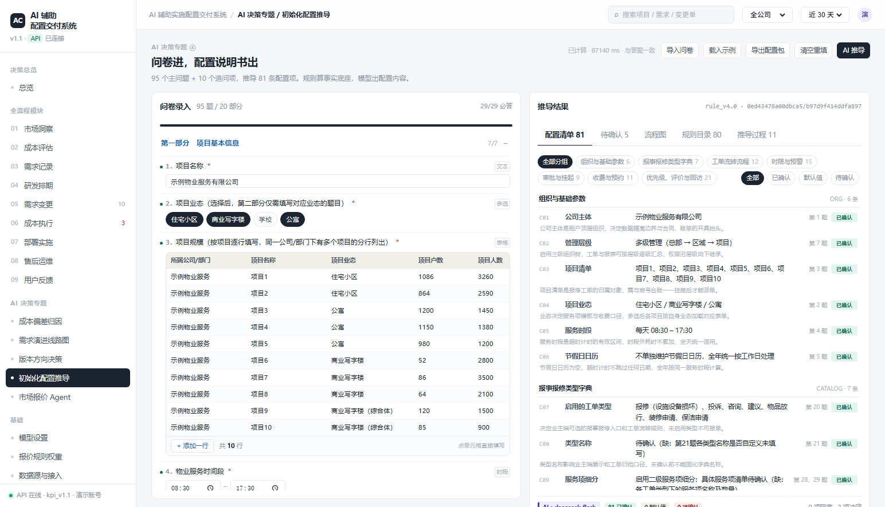

# AI 辅助实施配置交付系统

**客户把一份 105 项的 Word 问卷填回来，系统产出 81 条系统配置 + 分层流程图 + 冲突清单。**

To B 实施项目里最耗人的一段是：顾问拿着问卷去客户那儿问两天，回来对着 81 条配置一条条写说明书，写完再跟客户逐条确认。这个项目把这一段做成了工具。

推导对象是真实业务模块——**报事报修**（物业 / 园区 SaaS 的核心模块），那 81 条就是实施时真的要写进系统的东西，不是抽签选的示例功能。



## 为什么不直接把问卷丢给大模型

这是整个项目的核心判断：**数字由规则算，模型只负责写话。**

| | 一把梭让模型生成 | 本项目 |
|---|---|---|
| 配置值谁定 | 模型 | 80 条规则分 7 组确定性推导 |
| 同一份答案重跑 | 每次都不一样 | `answer_hash` / `output_hash` 双指纹，必然相同 |
| 模型胡说 | 值被污染，还查不出来 | 值不由它给；编号校验、编造丢弃、漏项回落规则值 |
| 错在哪一条 | 说不清 | 每条记来源 `rule / llm / override`、规则版本、冲突标记 |
| 模型挂了 | 整页空白 | 该组回落规则值，事件里写明原因，界面红条提示 |
| 成本 | 不可控 | 一次推导 13 次调用 / 66 秒 / 约 2 分钱（deepseek-flash） |

实测：**81/81 条全部由模型生成、0 回落、13 次调用全成功、66 秒。**

## 目录

```
survey-to-config/
├─ backend/                               FastAPI + SQLite，指标全部现算
│  ├─ app/analytics/rules/                7 组 80 条配置规则
│  │                                      org / catalog / flow / sla / approval / fee / priority
│  ├─ app/analytics/config_engine_v4.py   推导编排、三态归属、状态机、双 hash
│  ├─ app/analytics/conflicts.py          14 条跨题冲突，声明式
│  ├─ app/analytics/survey_import.py      docx 问卷解析（勾选框 / 表格 / 下划线填空）
│  ├─ app/analytics/llm_derive.py         规则先算 → 分组调模型 → 校验兜底
│  ├─ app/knowledge/                      survey_96.json（105 个作答项）
│  │                                      config_items.json（81 条定义）
│  └─ tests/                              299 项
└─ frontend/                              原生 JS，零构建依赖
   └─ tests/                              jsdom 190 项 + 6 个真浏览器 CDP 脚本
```

## 快速开始

**Windows**：双击 `backend/start.bat`，等依赖装完会自动打开。

**macOS / Linux / WSL**：`bash backend/start.sh`

| 地址 | 说明 |
|---|---|
| http://127.0.0.1:8010/ | 页面（后端同源托管前端），未登录会跳到登录页 |
| http://127.0.0.1:8010/login.html | 登录页，演示账号 `demo` / `demo1234`（页面上有一键填入） |
| http://127.0.0.1:8010/docs | 自动生成的接口文档，可直接试调（先在 `/api/auth/login` 拿 token） |
| http://127.0.0.1:8010/api/bootstrap | 首屏数据，一次拉全（需 Bearer token） |

想直接看推导结果：`#/topic-config?demo=1` 会载入示例答案并自动跑一次（已配置模型则走 AI 推导，否则走规则）。

首次启动会建库并灌入演示数据（`backend/data/app.db`）。想重置：

```bash
cd backend
SDLC_RESET=1 .venv/Scripts/python.exe run.py      # Windows PowerShell: $env:SDLC_RESET="1"
```


## 核心链路：105 个作答项 → 81 条配置

v3 是 6 题示例（证明"确定性推导"这件事能成立），v4 是真实交付形态：**105 个作答项（95 主问题 + 10 追问）→ 81 条配置项 → 可交付说明书**。

| 层 | 位置 | 内容 |
|---|---|---|
| 问卷模板 | `backend/app/knowledge/survey_96.json` | 20 部分 / 8 类题型 / 分支题 / 表格题 |
| 配置清单 | `backend/app/knowledge/config_items.json` | C01–C81 的编号、名称、分组 |
| 规则 | `backend/app/analytics/rules/` | 7 个分组模块，80 条规则 |
| 冲突 | `backend/app/analytics/conflicts.py` | A1–A14 跨题冲突，声明式 |
| 引擎 | `backend/app/analytics/config_engine_v4.py` | 编排、三态归属、状态机、双 hash |
| 前端 | `frontend/assets/config96.js` | 问卷录入 + 配置清单 + 待确认 + 流程图 + 规则目录 |

规则按说明书的 7 个分组拆，编号与配置项一一对应：

```
org C01-06     6      catalog C07-13   7      flow C14-25    12
sla C26-40    15      approval C41-49  9      fee C50-60     11
priority C61-81 21    —— 合计 81 条 / 80 条规则
```

新增接口：

| 方法 | 路径 | 说明 |
|---|---|---|
| POST | `/api/config/derive` | 按入参题号自动分流 v3/v4；`{"template":"survey_96"}` 可强制 v4 |
| POST | `/api/config/derive/stream` | 同一次推导的 SSE 版：12 步过程 + done 带回完整结果 |
| GET | `/api/config/v4/template` | 96 题模板 |
| GET | `/api/config/v4/items` | 81 条配置项定义 |
| GET | `/api/config/v4/rules?group=sla` | 规则目录（可按组过滤） |
| GET | `/api/config/v4/conflicts` | 14 条可检出的冲突 |
| POST | `/api/config/import-survey` | 上传回填 docx → 返回 `answers` + `report`；**不推导** |

前端入口：`#/topic-config`。带 `?demo=1` 直接载入示例答案（已脱敏）并自动跑一次推导，`?demo=1&tab=issues` 可直达某个页签。

**交互约定（v4.1，2026-10-19 改）**

- **不自动重算**：填问卷只记录答案，点右上角「AI 推导」才推导（唯一计算入口）。v4.0 是每个 `input` 事件都触发 derive → 整页重绘，输入框失焦、滚动位置丢失，看起来像页面在刷新。
- **局部重绘**：输入时只就地刷新进度条与圆点；点选项只改按钮选中态；只有分支可见性变了才重绘左栏（用可见题号串做签名判断）。
- **推导过程可视化**：点确认后右栏切成 Agent 面板，逐条显示 12 步——读取答案 / 7 个规则分组 / 配置对账 / 冲突扫描 / 状态机 / 指纹，每步都带真实的规则数、配置数、命中编号和耗时。过程与结果同源（`derive()` 与流式共用同一个生成器），不存在"动画走一套、结果走另一套"。跑完自动切回配置清单，过程保留在「推导过程」页签。
- **改动提示**：算完之后再改答案，顶栏显示「N 项改动未计算」，按钮变成「AI 推导 (N)」，结果不会被清空。
- **表格题是真表格**（v4.2，10-19 改）：9 道表格题按 `survey_96.json` 的 `table.cols` 渲染成单元格，一格一个 input。
  - 列名带「序号」的列**只读自动编号**，不占输入；其余列可自由填，部分列挂 `datalist` 给可选值（业态 / 工单类型 / 优先级 / 审批级别 / 预警等级 / 超时时长）——能下拉也能手打，不覆盖已有值。
  - 每行右侧悬停出现 `×` 删行；底部「+ 添加一行」；在最后一行落笔会自动补一行；`Enter` 跳到下一行同列。
  - 提交前 `cleanAns()` 裁掉全空行与首尾空格——**界面留白行 ≠ 已答**。表格的空行如果不裁，`answered()` 会把没填的表当成填了，三态就被界面影响了。
  - 表头按「去空白后相等」匹配（`nkey`）：docx 里是「服务项  /  工单类型」（中间两个空格），问卷模板是「服务项 / 工单类型」，严格按列名取值会静默渲染成空白——踩过。

前端回归测试：`frontend/tests/config96.test.cjs`（jsdom）+ `frontend/tests/e2e_no_derive_on_click.py`（真 Chrome + CDP）
+ `frontend/tests/e2e_import_survey.py`（真浏览器上传真实 docx）。
专门锁"输入不重绘 / 不失焦 / 不自动算 / 点选项与单元格不许请求 `/api/config/derive`"这几件事。

**导入问卷（v4.3，2026-10-19 加）**

顶栏「导入问卷」→ 选客户回填的 **.docx** → 解析出答案 → **只填表单，不跑规则**。
要不要算由用户点「AI 推导」决定，导入过程零 `/api/config/derive` 请求（真浏览器抓包验证）。

| 能力 | 说明 |
|---|---|
| 解析对象 | 回填后的 Word 问卷：勾选框 `☑ / □`、题干内填空、下划线填空、Word 原生表格 |
| 题号对齐 | 按 `N.` 与 `survey_96.json` 的 `no` 对齐；原卷漏题号的（第 52 题）按题干兜底定位 |
| 表格题 | 题号后第一张表，**按列位映射**到 `table.cols`（第 61 题表头第二格是空的，靠列位才对得上） |
| 数值题 | 先删掉未勾选片段再取数——否则「□ 2小时」里的 2 会被当成客户填的数值；勾了单位没填数字则留 `{v: null, unit}`，交给 A3 冲突 |
| 文本题 | 排除「例如：」开头的示例段；「请说明……，例如：<回答>」取冒号后的部分 |
| 不造假 | 没勾选、表格空、只有示例的题一律进 `report.skipped`，绝不补默认值 |
| 报告 | 返回 `filled / skipped / mismatch / inferred_unit`，左栏顶部提示条直接列出未识别题号 |
| 脱敏 | 封面信息表里的手机号、填写人不会进答案（有测试断言） |

边界：只收 `.docx`（`.doc` 请另存）；超过 20MB 拒收；解析异常返回 400 并带原因，不静默失败。

> **踩过的坑**：`_drop_unchecked` 不能省。第 38 题原卷写「单位：□ 分钟　□ 2小时　☑ 天」，
> 不删未勾选项就会把「2小时」的 2 读成答案，输出 `{v: 2, unit: day}`——看起来完全合理，
> 但客户其实没填数值。这类"看起来对"的错最危险。

**待确认处理弹窗（v4.4，2026-10-19 加）**

「待确认」不再是只读列表，也不再是 `alert()`。点任意一条（或点配置清单里任意一行）打开弹窗，**就地处理**：

| 区块 | 作用 |
|---|---|
| 问题说明 | 冲突编号、说明、建议、受影响的配置项（点开可看现值） |
| 修正答案 | 把涉及的题目渲染成可编辑控件（单选/多选/数值+单位/文本/时段/**表格**），改完打「已改」标记 |
| 或直接确认配置值 | 问卷里根本没依据的（如「月 vs 30 天」口径），顾问直接拍值 + **必须写理由** |
| 底栏 | 实时显示「已改动 N 处」，保存即重算；没改动时按钮禁用 |

两条路都走真闭环：

- **改答案** → 合并进 `S.ans` → 重算 → 冲突规则的前置条件不再满足，该条自然消失（实测 A10 从待确认里消失，3 条变 2 条）
- **人工确认** → 随推导提交 `overrides: {C65:{v, why, at}}` → 后端 `_apply_overrides` 落值、`st` 置 ok、note 追加「人工确认：<理由>（时间）」，`stats.overridden` 计数 +1

三条硬约束：

1. **没理由不收**——`v` 或 `why` 任一为空直接忽略，界面上也不允许保存（提示「N 条人工确认值没写理由」）
2. **确认值进指纹**——`answer_hash(ans, overrides)`，同答案 + 不同确认值必然不同 hash；同答案 + 同确认值必须可复现
3. **冲突标记保留**——人工确认只把 `st` 从 tbd 提为 ok，`conflict` 字段还在（冲突客观存在，只是人拍板了），保证可追溯

「定位到原题」遇到题目被分支挡住（如选了标准流程，第 27 题不适用）时不假装跳过去：弹窗不关，直接说明「第 X 题在当前答案下不适用，先改前置题」。

**表格题在弹窗里也能改（v4.7）**：左栏那套表格控件绑的是 `S.ans`，弹窗里绑的是 draft，不能直接复用，所以做了一份同形态的紧凑版——序号列只读自动编号、其余格直接输入、行可增删、`colgroup` 固定列宽（序号 46px，其余平分）。输入时只写 draft 不重绘，焦点不丢；保存时 `cleanTableVal()` 裁掉界面为录入方便留的空行——**留白行 ≠ 已答**。

前端回归：jsdom 交互回归 + 真浏览器 `frontend/tests/e2e_issue_modal.py`（改答案 / 人工确认两条路各跑一遍，抓 postData 确认真的带上了）；后端 `backend/tests/test_override.py` 13 项。

**「仅保存」通道（v4.5，2026-10-19 加）**

弹窗底栏两个保存动作，语义分得很清：

| 按钮 | 做什么 | 会不会算 |
|---|---|---|
| **仅保存** | 改动写进 `S.ans` / `S.overrides`，再 POST 到 `/api/config/draft` 落库 | **不算**，零推导请求 |
| 保存并计算 | 同上，然后立刻 `runDerive()` | 算 |

为什么要分开：实际实施时会连着处理好几条待确认（改答案、填人工确认），中间不该每改一条就重算一遍——重算会把结果刷新、把弹窗关掉、还可能冒出新的冲突打断思路。先存着，攒完一次性算。

配套的三件事：

1. **草稿能捡回来**。打开页面自动 `GET /api/config/draft`，有草稿且当前答案为空时恢复（`?demo=1` 时以示例为准，不覆盖）。恢复**不触发推导**，右栏仍是「等待计算」空态。
2. **顶栏说清楚状态**。「草稿 20:00 已存」与「1 项改动未计算」并排显示——存过不等于算过，不能让人误以为已经有结果。
3. **算完草稿作废**。`runDerive()` 成功后清 `savedAt` 并 `DELETE /api/config/draft`，否则下次开页面又把旧草稿捡回来，跟刚算出来的结果打架。「清空重填」同样会清草稿。

数据落在 `config_drafts` 表（`template_id / answers / overrides / saved_at / saved_by`），与 `survey_answers` 分开：那张表是"已确认、参与推导"的答案，这张是改到一半的草稿。

测试：后端 `backend/tests/test_draft.py` 6 项（存/读/覆盖/清除/不做推导）· 真浏览器 `frontend/tests/e2e_save_draft.py` 17 项（保存只发草稿请求 → 刷新恢复 → 计算后草稿作废，全程抓包）。

**大模型配置与 AI 推导（v4.6，2026-10-19 加）**

侧边栏「基础 / 模型设置」（`#/llm-config`）。以前配模型只能改环境变量重启服务，实施到客户现场没法这么干。

| 项 | 说明 |
|---|---|
| 服务商 | DeepSeek（推荐）/ OpenAI / 任意 OpenAI 兼容（通义、豆包、本地 vLLM） |
| 配置项 | base_url、模型名、API Key、温度（0–1，推导建议 0.1–0.3） |
| 测试连接 | 发一条最小请求，把「key 错 / base 错 / 模型名错」当场分清楚，并显示延迟与 tokens |
| 生效方式 | 存 `llm_configs` 表，**保存即生效，不用重启**；优先级 DB > 环境变量 > 离线 |
| 安全 | api_key 只存本机 sqlite，接口只回 `sk-1****cdef` 脱敏串；只改模型名时传回脱敏串会复用原 key |

**AI 推导**：配置推导页顶栏新增「AI 推导」按钮（未配置时禁用，title 写明去模型设置）。

它不是把 81 条丢给模型编，而是：

```
规则引擎先算一遍          → 81 条作为「事实底座」与兜底来源
   ↓
按 7 个分组逐组调模型      → 每组：该组答案摘要 + 配置清单（含规则草案）
   ↓                       → 模型返回 [{code, v, note}]，note 写依据
校验 + 兜底               → code 必须在清单内、值不能空；
   ↓                        漏的/给错的/格式坏的 → 回落规则值，标 by='rule'
冲突扫描 / 状态机 / 指纹   → 与纯规则推导共用 finalize()，口径完全一致
```

结果里每条配置带 `by: 'llm' | 'rule'`，统计条显示 `AI · deepseek-flash` 或 `规则引擎`。推导过程逐组显示「6/6 条由 deepseek-flash 生成 · 1832 ms」，每次调用的 tokens 与耗时都能对账。

成本（实测）：一次完整推导 **13 次调用**（7 组、长组拆批）、**10.6k 输入 / 13.5k 输出 token**、**66–79 秒**，DeepSeek 单次 2 分钱左右。

降级策略（都会明说，不装样子）：

- 没配模型 → 点 AI 推导直接被拦（提示去模型设置），不会偷偷跑规则
- 某组调用失败（网络/401/JSON 坏）→ 该组整体回落规则值，事件里写明失败原因，页面顶部红条提示
- 模型编造不存在的 code → 丢弃并计数，配置项集合始终是 81 条

测试：`backend/tests/test_llm.py` 14 项（配置存取/脱敏/复用 key/假模型出内容/漏项兜底/编造编号丢弃/模型挂掉整批回落/流式逐组回显）+ jsdom 新增 12 项（未配置禁用、点了不推导、走 AI 通道、结果标 AI）。

**模型名以服务端为准 + 长组拆批（v4.9，2026-10-19）**

先前在页面里写死 `deepseek-v4.1-flash`，DeepSeek 直接 400：
`The supported API model names are deepseek-flash, deepseek-v4-pro`。
模型名是厂商说了算的活物（连 `deepseek-chat` 都已下线），写死必然过期，所以：

| 改动 | 说明 |
|---|---|
| 推荐列表 | `deepseek-flash`（默认，快且省）/ `deepseek-v4-pro` |
| `GET /api/llm/models` | 用已存 key 调 `{base}/models`，把服务端真实可用列表拉回来 |
| 页面 | 进页面自动探测（有 key 才探）；chips 换成真实列表；当前填的名字不在列表里就标红提示「保存后必然 400」；测试连接因模型名失败时自动探测一次 |
| 拆批 | 一组超过 8 条就拆批调用。21 条一次要，输出的 JSON 会长到被 `max_tokens` 截断，截断的后果是**整组回落**——看着像"模型不行"，其实是字数不够 |
| 重试 | 单批失败重试 1 次（温度降到 0）。401/403/400/余额不足/模型名错不重试，白花时间 |
| `max_tokens` | 默认 1600 → 4000 |

实测（示例物业，`deepseek-flash`）：**81/81 条全部由模型生成，0 回落，13 次调用全成功，66 秒**。
配置说明也随之由模型改写，例如 C01「公司主体是系统顶层租户，决定数据隔离边界、账单与开票抬头」。

测试：`test_llm.py` 20 项（新增模型列表探测 5 项、长组拆批 1 项）+ `test_flow_desc.py` 断言推荐列表不含已下线的名字。

**非 ASCII 拦截（v4.10）**

现象：粘贴 API Key 后报 `'ascii' codec can't encode characters in position 7-10`。

原因：那头 7 个字符是 `Bearer `，第 8 位起是 key 的内容 —— **key 里混进了中文/全角/零宽字符**（从聊天窗口复制时极常见）。HTTP header 只能 ASCII，httpx 在底层炸掉，报错信息跟"key 有问题"毫无关联。

三层处理：

| 层 | 行为 |
|---|---|
| 入网前 | `_assert_ascii()` 拦 key / base_url / model，报「第 N 位 U+4E2D」这种能定位的话 |
| 入库前 | `config_store.save()` 拒收脏 key（否则脏数据落库，之后每次推导都炸，还查不出原因） |
| 页面 | 输入时就地标红「检测到 N 个非 ASCII 字符（第 X 位 U+XXXX）」，重绘后也不消失；旁边「清理」按钮由用户主动点，清完告知去掉了几个字符 |

测试：`test_llm.py` 25 项（新增 5 项：中文 key 拒绝入库、零宽字符拒绝、中文模型名拒绝、测试连接给出可读原因、正常 key 仍可保存）。

**对齐说明书：配置说明 + 分层流程图（v4.8）**

参照《报事报修配置说明书》重做了两处输出：

**1. 81 条配置每条都有「配置说明」**

`config_items.json` 增加 `about` 字段（这条配置在系统里管什么），推导时落到每条配置的 `desc`：

```
C05 服务时段   每天 08:30 – 17:30   第 4 题   已确认
    服务时段是超时计时的有效区间，时段外耗时不累加
```

配置清单每条下面一行灰字，弹窗里也显示；AI 推导时模型还会按上下文改写这句说明（prompt 里要求 20–40 字、写怎么落地）。

`desc` 不进指纹——文案调整不该让历史指纹全变，`output_hash` 只取 `code/v/st/src/rule/by/override/conflict`。

**2. 流程图改成「泳道 × 阶段」两层**

以前是一串箭头节点，现在每个节点带 `lane`（谁负责）和 `col`（什么时候）：

| 泳道 | 职责 |
|---|---|
| 提报端 | 业主端提报 / 员工端代报 |
| 客服中心 | 受理、派单、归档 |
| 处理人 | 待接收、待处理、处理中、挂起 |
| 审批 | 审核中、关闭审批 |
| 评价 / 回访 | 待评价、待回访 |

9 个阶段列：提报 → 受理派单 → 接单 → 待处理 → 处理中 → 审核 → 评价 → 回访 → 归档。

节点带业务说明（「处理人确认接单，限 30 分钟，超时触发升级」），挂起/报价确认/关闭审批作为**并行分支**用虚线框画在对应位置，不混进主链路。切到流程图页签时自动隐藏问卷栏占满整行（9 列在右栏必然横向滚）。

测试：`backend/tests/test_flow_desc.py` 14 项（81 条说明覆盖率、说明不是复述名称、文案不影响指纹、5 条泳道、节点落位、阶段递增、审核节点按第 25/27 题联动、模型列表含 v4.1-flash）。

> **踩过的坑（别再犯）**：`app.js` 里有一个全局点击委托 `document.addEventListener('click', ... closest('[data-proj],[data-q],...'))`，是 v3 内联问卷的遗留。v4 的选项按钮同样带 `data-q`，于是一点就被它抢走：往 `state.ans` 塞值 → `render()` 整页重建 → 再补一发 `POST /api/config/derive`，表现就是"点一下问卷，页面刷新一次"。
> 现已把 `[data-q]`/`[data-opt]` 从选择器里删掉、删掉对应死分支与 `refreshDerived()`，并在委托入口加了一道 `if (e.target.closest('#c96-root')) return;` 让路。


**与人工版说明书的对拍结论**（详见 `P0_对拍报告_配置推导v4.md`）：81 条里 58 条实质一致、2 条规则比人工版完整、21 条不一致——这 21 条全部是"人工版的值不等于问卷答案"（顾问补值/改判），不是规则算错。其中 11 条属于与问卷选项直接矛盾，是交付风险点。

**这一版有意不做的事**：不做 docx 导入（P2）、不做 PDF 导出（P1）、不做人工覆盖字段的记录（P1 建议项）。前端不再保留第二套推导逻辑，离线时只读，不降级计算。


## 底座：只存原始事实，指标全部现算

这个项目最容易做错的地方是：后端只是把前端那些写死的数字搬到 JSON 里。那样一来，"AI 决策"仍然是死文案。

这里的做法是**只存原始事实，所有指标在查询时计算**：

| 存下来的 | 算出来的 |
|---|---|
| 人天流水（base / scope / rework / efficiency / wait） | 实际人天、五项偏差分解、返工占比、CPI、EAC |
| 变更单（诱因、计价归属、提交与评估时间） | 留痕率、变更响应时长、同因复现、C1/C3 占比 |
| 需求与它的每一次交付（rev 1.0 → 3.0） | 需求返工率、一次通过率、演进链、经验卡召回 |
| 工单（模块 × A/B/C/D 四类） | 咨询占比、四类结构、入口问题判定、P90 首响 |
| 问卷答案 | 配置清单、流程图、冲突项（规则引擎推导） |

所以 P-2026-014 的"超支 48 人天 = 范围 22 + 返工 14 + 净效率 12 + 等待 0 + 基线 0"不是写在代码里的常量，而是把人天流水求和后拆出来的。改一条人天记录，整页数字跟着变。

### 五项分解与闭合校验

```
实际 = 估算 + ①范围 + ②返工 + ③净效率 + ④等待 + ⑤基线残差
闭合率 = |未分类工时| / 总偏差        （阈值 5%，超过判 data_gap）
未分类工时 = 财务上报人天 − 分类工时合计
```

⑤ 是残差项（`基线实际工时 − 估算 + 未分类工时`），四项解释完剩下的都归到它。闭合校验不看 ⑤ 自己，而是看**财务上报数与分类工时之间的差**——这才是真实世界里会漏东西的地方。

演示数据里 P-2026-021 故意留了 6 人天未分类：上报 102、分类 96。系统会算出闭合率 15.8%，判 `data_gap`，并在结论里写"另有 +6.0 人天工时未进分类，上述归因需打折看"。

### 数据源治理

每个数字都能回答"从哪来、什么时候来、断了怎么办"。`backend/app/seed_sources.py` 注册了 59 条源，覆盖九个模块 × 四种通道：

| 通道 | 条数 | 角色 | 能否当主源 |
|---|---|---|---|
| API | 25 | 事实主动脉 | 能，且应该 |
| MCP | 11 | Agent 按需取数的手 | 不能（无法追溯、无水位线、会限流） |
| Excel 导入 | 15 | 断点补丁 / 财务口径 | 能，但仅限财务结算与人工台账 |
| 互联网公开数据 | 8 | 参照标尺 | **永远不能** |

规则写在数据库里而不是文档里，所以可以断言：

- 每条 MCP 源必须登记背后系统 + 工具名，否则测试失败（`test_mcp_sources_declare_backing_tool`）
- 每条公开源必须有真实 endpoint，点"探活"会真的发 HTTP
- 需求记录 / 变更 / 成本执行三个模块**没有**公开数据源——需求是客户给的、变更是双方谈的、成本是自家账
- 指标血缘：`actual_days` = 财务系统（主源）+ 工时系统（校验源），冲突不覆盖，记入 `source_conflicts`

**导入是真的能跑**：`#/sources` 页面上传 CSV/XLSX → 逐行校验（项目号是否存在、类别是否在五类枚举、人天是否 >0 且 <=200、月份格式）→ 坏行带行号返回 → 确认后才落库。同一文件按 `content_hash` 幂等，重复上传会被拒绝并告诉你上次的批次号。

导入后不用手动刷新：服务端立刻回算闭合率并回显。实测导入 2 行（3.5 人天）后，P-2026-021 的闭合率从 15.8% 降到 6.6%——补的就是那 6 人天未分类工时的一部分。

### 配置推导为什么不用大模型

`backend/app/analytics/config_engine.py` 里 13 条规则，每条有 ID、有单测、有版本号（`rule_v3.4`）。输出里带 `input_hash` 与 `output_hash`：

```bash
curl -X POST http://127.0.0.1:8010/api/config/derive \
  -H "Content-Type: application/json" \
  -d '{"answers":{"Q3":3,"Q7":"m","Q12":"subtree","Q18":5000,"Q21":false,"Q25":"fin"}}'
```

同一份答案（哪怕键顺序不同）`output_hash` 必然相同；改一个答案必然不同。这是"同一份问卷重跑两次结果一致"的可验证形式，也是任何"让模型生成配置"的方案必须先回答的问题。

答案缺失或冲突时不猜：输出 `tbd` + 阻塞项。例如 Q12 选"区域看下属门店"但 Q3 只有 2 级组织，会直接判阻塞，配置写"无法推导（组织层级不足）"。


## 同源专题：市场报价 Agent
> 下面这块和配置推导共用同一套数据底座与同一条「代码算数、模型写话」原则，是同期做的另一个专题。


从一句客户原话到一张能发出去的报价单，中间要过 18 个阶段，其中三道关卡会**自己退回去重跑**，而不是硬着头皮往下走。

```
需求输入 S01
  → 推理层 S02 → 需求理解与拆解 S03 → 关键词提取 S04 → 明确度判断 S05
        ↑                                                      │
        └──── 反向追问 S06 ←── 不足（<60%，只为权重高的槽位提问）┘
                                    │ 充分
                                    ↓
   多维度检索 S07（历史报价库 / 行业经验库 / 客户档案库）→ 融合 S08
   → 候选方案 Top3-5 S09 → 置信度评估 S10
        ↑                        │
        └── 调整检索参数 S11 ←── 低于 70%（放宽相似度、扩大召回）┘
                                 │ ≥70%
                                 ↓
   需求相似度匹配 S12 → 定价规则引擎 S13（市场 / 客户 / 成本三规则各自出价）
   → 多规则融合 S14 → 利润率校验 S15
        ↑                  │
        └── 重新评估 S16 ←── 毛利 <15%（授权内自动提价，超授权转特批）┘
                           │ ≥15%
                           ↓
              完整报价单 S17 → 人工复核 S18
```

**三条回环是这套东西的价值所在。** 一条需求一次通过，说明不了什么；能说清"什么情况下它拒绝出价、退回去补什么"，才是可交付的推理系统。演示数据里刻意留了四条路径：

| 需求 | 客户 | 走到哪 | 结果 |
|---|---|---|---|
| QR-2026-001 | 华辰控股 | 一次通过 | 明确度 94%、置信度 95%、93.3 万、毛利 31.8% |
| QR-2026-002 | 星野数字 | 明确度不足 → 补答 → 置信度不足 → 调参 | 4 条追问（2 条阻塞）；补答后 121.9 万、毛利 35.5% |
| QR-2026-003 | 康泰医疗 | 毛利校验不过 | 毛利 5.5%（低于 15% 下限），转商务特批，给三条出路 |
| QR-2026-004 | 正弘法务 | 停在追问 | 明确度 42%，5 条追问（3 条阻塞），不出价 |

### 定价为什么必须由代码算

引擎文件头写着一条约束：**定价计算与阈值判定必须由代码完成**。理由不是"模型算不准"，而是：

> 同一个需求，今天报 98 万、明天报 112 万，业务方没法向客户解释。

所以：

- 三规则各自独立出价（市场对标分位 / 客户等级折扣 / 成本加成），再按权重归一化融合。权重在页面上改，改完立刻影响下一次推理。
- 市场规则的可计价样本少于 `min_samples`（默认 3）时**降权而不弃权**：按 `样本数 / min_samples` 折算它的融合权重，并在定价依据里写明。弃权会让权重全让给成本加成，报价系统性偏高。
- 三规则出价分歧超过 20% 时取中位数，并在结论里标"需人工判断"——不让融合公式把分歧抹平。
- 完整输出带 `input_hash` 与 `output_hash`，同输入（哪怕 JSON 键顺序不同）必得同一价。单测直接断言这件事。
- 置信度是四个分量的加权：明确度 0.35 / 检索证据 0.30 / 客户熟悉度 0.15 / 价格一致性 0.20。证据分用**绝对口径**（Top1 相似度 ÷ 0.75 封顶、覆盖率、样本量），不是归一化后的相对分——否则 Top1 永远是 1.0，置信度会虚高到没有区分度。

### 三库融合用 RRF，不用加权求和

历史报价、行业案例、客户档案三路检索，分数量纲不一样（词频余弦、模板匹配度、交易相似度），直接相加等于让某一库说话。这里用加权 RRF：

```
score += weight_i × 1 / (k + rank_i + 1)      k = 60
```

最后归一化到 0~1。好处是不需要三路分数可比，只看排名；坏处是丢掉分数差距信息——所以置信度里另算一个绝对的 `sim` 分来补。

检索本身是**纯标准库实现的稀疏向量**：词典词 ×3、中文双字组 ×1、英文 ×2，IDF 加权余弦。没有引入 embedding 模型，是为了让"为什么召回这一条"可以逐项拆开看——真接向量库时，这个接口契约不用变。

### 规则权重在另一个页面改

`#/pricing-rules` 与报价工作台分离，因为这是两件事：一个是"这一次报多少"，一个是"以后怎么报"。

- 改权重 → 保存 → 生成新版本（`w_v1` → `w_v2` …），之后每次推理用新版本
- **已出的报价单锁定在它生成时的版本**，不会被追溯改写
- 改之前可以「影子试算」：拿历史需求用草稿权重重算一遍，看价格、毛利率、结论状态怎么变，**不落库**
- 硬约束不可禁用（毛利率下限），定价规则至少留两条——只剩一条就不叫多规则融合了
- 参数越界直接 400 报错，不静默夹逼——夹逼会让人以为改动生效了

### 人工复核

复核是流程里唯一的人工闸门，不是点个"确认"就完事：

| 决策 | 含义 | 约束 |
|---|---|---|
| 通过 | 认可系统报价 | 必须写意见 |
| 调价通过 | 改价后放行 | 必须写意见，且**不得低于成本** |
| 驳回 | 退回重来 | 必须写意见 |

提交后状态锁定为「已复核」，重复提交返回 409。复核记录带复核人、时间、最终价，进审计日志。

### 对话澄清与 LLM 接入

中栏是一块 SSE 流式对话：自由回答 → 槽位抽取 → 自动重推，一个连接完成一个回合。三条设计红线：

- **模型只做三件事**：追问话术、槽位抽取、结论解读。定价计算与阈值判定永远由代码完成——同一个需求今天报 98 万明天报 112 万，业务方没法向客户解释。
- **抽取可溯源**：每个槽位带置信度（≥0.8 自动写入 / 0.5–0.8 向你确认 / <0.5 继续问）和原文 evidence；每次调用落 `llm_calls`（节点 / 模型 / token / 耗时），推理链节点上直接打「LLM / 模板 / 代码」徽标——哪一步有模型参与，一眼可答。
- **离线是底线不是摆设**：无 `SDLC_LLM_KEY` 时全链路降级为模板话术 + 正则抽取（"八百个律师用"照样变成 scale=800），SSE 事件序列一帧不少，前端不区分在线离线。

默认模型 DeepSeek（`deepseek-chat`，约 ¥2/M 输入），不接 Kimi；换任意 OpenAI 兼容模型只改 `SDLC_LLM_BASE` / `SDLC_LLM_MODEL` 两个环境变量。毛利不足时还有两条可执行出路：**缩范围**（砍覆盖率最低的模块回定价引擎重算，至多 1 轮）与**驳回重跑**（复核意见"总价 80 万以内"被抽取为硬约束进下一轮）。规则页的「改前回归」在保存前用当前草稿对历史需求全量重算，状态翻转与价差超 ±10% 会置顶提示。


## 接口

| 方法 | 路径 | 说明 |
|---|---|---|
| GET | `/api/bootstrap` | 首屏全量数据 |
| GET | `/api/overview` | 组合指标、预警、三条回写链路 |
| GET | `/api/projects` | 项目列表（含 CPI / EAC） |
| GET | `/api/projects/{id}` | 单项目 + 人天流水 + 变更单 |
| GET | `/api/projects/{id}/variance` | 五项分解（仅 full 级项目，否则 409） |
| POST | `/api/projects/{id}/variance/recompute` | 重算并写审计（需 pm/admin） |
| GET | `/api/modules/{key}` | 九个模块任一 |
| GET | `/api/topics/variance` | 专题①成本偏差 |
| GET | `/api/topics/lineage` | 专题②需求演进链 |
| GET | `/api/topics/version` | 专题③版本方向 |
| POST | `/api/config/derive` | 专题④配置推导（确定性） |
| GET | `/api/config/rules` | 规则目录（ID / 输入 / 输出） |
| GET | `/api/config/export` | 导出配置包 JSON |
| POST | `/api/survey/{id}/answers` | 保存问卷并重推（需 pm/admin） |
| POST | `/api/hypotheses/{id}/review` | 假设回看，必须填结论 |
| GET | `/api/metrics` | 指标口径字典（带版本） |
| GET | `/api/audit` | 审计日志 |
| GET | `/api/sources` | 数据源注册表（可按 type / module 过滤） |
| GET | `/api/sources/summary` | 源总数、T1 占比、降级/待配置/过期清单、冲突 |
| GET | `/api/sources/matrix` | 九模块 × 四通道覆盖矩阵 |
| GET | `/api/sources/{id}` | 单条源（字段、去重键、质量规则、降级方案） |
| POST | `/api/sources/{id}/probe` | 真实探活（公开源会发 HTTP；内网源返回 not_configured） |
| GET | `/api/sources/metrics/{id}/lineage` | 指标 → 源血缘（主源 / 校验源） |
| POST | `/api/ingest/effort/preview` | 上传体检：逐行校验，不落库 |
| POST | `/api/ingest/effort` | 落库（需 pm/admin，hash 幂等） |
| GET | `/api/ingest/batches` | 导入批次回执 |
| GET | `/api/ingest/template` | 下载导入模板 CSV |
| GET | `/api/pricing/overview` | 报价总览：需求队列、18 阶段拓扑、规则版本 |
| GET | `/api/pricing/requests/{rid}` | 单条需求 + 逐槽位拆解 |
| POST | `/api/pricing/requests/{rid}/run` | 跑完整推理（可带补答参数），落库 |
| GET | `/api/pricing/runs/{run_id}` | 一次推理的完整 trace（18 节点 + 回环标记） |
| POST | `/api/pricing/runs/{run_id}/review` | 人工复核（三态，需 pm/admin） |
| GET | `/api/pricing/quotes` | 报价单列表 |
| GET | `/api/pricing/rules` | 当前规则 + 版本历史 + 参数边界 |
| PUT | `/api/pricing/rules` | 保存为新版本（需 pm/admin） |
| POST | `/api/pricing/rules/simulate` | 影子试算（不落库） |
| POST | `/api/pricing/rules/regress` | 改前回归：当前草稿对历史已报价需求全量重算对比 |
| POST | `/api/pricing/rules/reset` | 恢复出厂默认（需 admin） |
| POST | `/api/pricing/runs/{run_id}/rerun` | 驳回后带意见重跑：意见抽取为约束进下一轮（需 pm/admin） |
| GET | `/api/pricing/llm-calls` | LLM 调用审计：节点 / 模型 / token / 耗时 |
| GET | `/api/pricing/dialogue/llm-status` | 在线 / 离线与模型名 |
| GET | `/api/pricing/dialogue/{rid}/history` | 对话历史（含槽位抽取留痕） |
| POST | `/api/pricing/dialogue/{rid}/turns` | SSE 流式对话回合（meta/delta/extract/question/run_start/stage/quote/error） |

### 鉴权

登录页 `/login.html`：账号 + 密码换 **JWT（HS256）**，之后每次请求带 `Authorization: Bearer <token>`。未登录访问任何业务页会被挡到登录页，并带回跳地址；登录成功原路返回。

```
POST /api/auth/login   {username, password}  → {token, token_type, expires_in, user}
GET  /api/auth/me      → 当前用户（每次回查库，角色改动立即生效）
POST /api/auth/logout  → 无状态，前端清凭证
GET  /api/auth/demo    → 演示账号提示（登录页「一键填入」用它，生产应删）
```

**演示账号**：`demo / demo1234`（admin）。种子用户密码同为 `demo1234`，可用 `zhoumin@demo.cn`(pm)、`wanglin@demo.cn`(viewer) 验角色差异。

实现要点：

| 事项 | 做法 | 原因 |
|---|---|---|
| JWT 签发 | 标准库 hmac + base64url 自实现 HS256，零依赖 | 引 PyJWT 只为 30 行代码，多一个部署依赖；产出的 token 在 jwt.io 可验签 |
| 密钥 | `SDLC_JWT_SECRET` 优先，否则落盘 `data/.jwt_secret` | 重启不退登录，演示现场最忌中途掉线 |
| 有效期 | 8 小时（`SDLC_JWT_TTL` 可调），`exp` 必校验 | 无状态凭证必须有明确失效点 |
| 密码存储 | PBKDF2-HMAC-SHA256，12 万轮 + 16 字节随机盐，`compare_digest` 比对 | 库里没有明文；同密码不同哈希 |
| 失败提示 | 账号不存在与密码错误都返回「账号或密码不正确」 | 区分两者等于白送账号枚举接口 |
| 网关 | 中间件 deny-by-default：除 `/api/auth/login`、`/api/auth/demo`、`/api/auth/logout`、`/api` 外的 `/api/*` 全部要 token | 60+ 端点逐个加 Depends 必漏；默认拒绝更安全 |
| 开关 | `SDLC_AUTH=off` 关闭（仅后端单元测试用）；**默认 on** | 不因忘记配环境变量而敞开 |

> 升级提示：老库首次启动会自动补 `login_name` / `password_hash` 两列并建出 demo 账号（`db._migrate` + `db.ensure_accounts`），无需重置数据。
> 前端 401 统一清凭证跳登录页；SSE 与 multipart 上传通道也走同一套判断。

## 测试

```bash
cd backend
.venv/Scripts/python.exe -m pytest tests -q
```

299 个用例，覆盖七块：

- **配置引擎**：同答案同输出、键顺序无关、改一个答案必变、缺答案不补全、冲突可检出、历史问卷重跑稳定
- **五项分解**：五项之和 = 总偏差、返工不重复计入效率、脏数据能被闭合校验抓到、实际人天取上报口径
- **接口**：首屏契约完整、未登录 401、只读角色 403、汇总级项目 409、推导接口确定性
- **数据源与导入**：每模块有权威源、MCP 必带工具名、公开源必带端点、私有模块不硬凑公开源、导入逐行拒绝、文件 hash 幂等、导入不改写财务上报口径
- **报价 Agent**（22 个）：同输入必得同输出、明确度不足不出价、补答后从拆解环节重跑、置信度不足调参重检、毛利不足转特批、授权内自动上调、权重改变报价、报价单自洽、复核必填意见、调价不得低于成本、复核后锁定 409、硬约束不可禁用、定价规则不少于两条、影子试算不落库、数组型参数按下标保存
- **对话层**（8 个）：SSE 事件序列完整（离线也不缺帧）、对话抽取挂到本轮 run（溯源徽标有数据）、口语变参数且 evidence 是原文子串、驳回意见抽取为约束、缩范围至多 1 轮、改前回归结构、审计可查、对话写操作要登录
- **登录与 JWT**（13 个）：demo 账号签发标准三段 JWT、邮箱前缀也能登录、密码错与账号不存在提示一致、无密码直接 422、网关拦住未登录的业务接口、篡改签名/换密钥/过期 token 全部 401、密码不同盐不同哈希、坏哈希不 panic

报价这 22 个断言守的是五条底线，不是"接口能返回 200"：**确定性、不猜、不硬凑、不亏本、可追责**。

### 前端交互回归（jsdom，190 项）

```bash
cd frontend
npm install        # 只装 jsdom 一个开发依赖，前端本身零构建
npm test
```

锁的是交互契约，不是"能不能渲染"：输入不失焦、点选项不重绘整页、改答案不自动重算、点任何控件都不许请求 `/api/config/derive`、表格题留白行不算已答、草稿保存不发推导请求、未配置模型时点推导被拦且提示真的显示出来。

### 真浏览器端到端（6 个脚本）

需先启动后端，再用 `--remote-debugging-port=9334` 启动 Chrome：

```bash
backend/.venv/Scripts/python.exe frontend/tests/e2e_no_derive_on_click.py   # 点击不许触发推导
backend/.venv/Scripts/python.exe frontend/tests/e2e_import_survey.py        # 导入 docx 只填表
backend/.venv/Scripts/python.exe frontend/tests/e2e_issue_modal.py          # 改答案 / 人工确认两条路
backend/.venv/Scripts/python.exe frontend/tests/e2e_save_draft.py           # 仅保存 → 刷新恢复 → 算完作废
backend/.venv/Scripts/python.exe frontend/tests/e2e_login.py                # 登录链路 + 篡改 token
backend/.venv/Scripts/python.exe frontend/tests/shot_ai_derive.py           # 截图验收
```

jsdom 能测逻辑测不了"焦有没有掉、页面有没有闪"，所以关键交互都在真浏览器里跑过一遍，全程抓包断言请求序列。

## 数据表

`data_sources` `ingest_batches` `metric_sources` `source_conflicts` `projects` `effort_records` `requirements` `requirement_revisions` `changes` `iterations` `deployments` `tickets` `module_usage` `feedback_themes` `market_gaps` `estimate_baselines` `knowledge_cards` `hypotheses` `version_candidates` `survey_templates` `survey_questions` `survey_answers` `metrics_dict` `audit_log` `evm_snapshots` `app_settings` `module_content`

报价 Agent 另加 10 张：

`customer_profiles` `quote_requests` `quote_history` `case_templates` `price_rules` `price_rule_versions` `quote_runs` `quote_reviews` `quote_dialogues` `llm_calls`

其中 `quote_runs` 存了 `answers`（补答参数）和两枚指纹，所以任何一次推理都能原样复现；`price_rule_versions` 存全量快照而不是增量 diff，报价单锁定的 `rule_version` 才真的回得去；`quote_dialogues` 缓冲了每个回合的完整 SSE 事件序列（断线可补拉），`llm_calls` 是模型调用的账本。

建表语句在 `backend/app/schema.sql`，每张表上方有为什么这样拆的注释。

## 已知边界

- **演示数据**：20 个项目、186 条需求、379 张工单，按《架构设计 v1.0》的口径构造，不是真实客户数据。汇报时应说明是"按口径造的验收用例"。
- **单机 SQLite**：够演示，不适合并发写。换 PostgreSQL 只需改 `db.py`，SQL 层面没有方言依赖。
- **鉴权做到「能上线演示」，不是「能上生产」**：JWT（HS256，自实现，无 PyJWT 依赖）+ PBKDF2 密码哈希 + 落盘密钥（重启不退登录）；网关默认拒绝，`/api/*` 除登录外一律要 token。缺的是 SSO 对接、token 刷新、行级数据隔离（现在只做接口级鉴权）。
- **LLM 接在两处**：配置推导（规则先算 → 7 组逐组调模型 → 校验兜底）与报价 Agent（追问话术 / 槽位抽取 / 结论解读）。九模块的 `narratives.py` 仍是规则模板，没接模型——那些模块要的是口径稳定，不是文采。模型在任何地方都不算数：配置值由 80 条规则算，定价与阈值判定由代码算。
- **前端写操作做了三个**：重算分解、导出配置包、人天流水导入。新建变更单、编辑配置等表单没做。
- **数据源是注册表不是连接器**：59 条源登记了对象、字段、频率、降级方案，但只有公开源（8 条）配了真实 endpoint 可以探活；内网系统（Jira/金蝶/HR）需要部署时填地址与凭据，现在会如实返回 `not_configured`，不假装连通。
- **报价检索是稀疏向量不是 embedding**：词典词 + 中文双字组，靠 IDF 加权余弦。同义改写（"看板" vs "报表大屏"）召不回来，这正是 `MODULE_LEXICON` 存在的理由——扩词典能解决一部分，剩下要接真向量库。接口契约已按"检索层可替换"设计。
- **报价规则只有 10 条、历史样本 14 条**：市场对标规则设了 `min_samples=3`，样本不足时按比例削权（如样本 2 条 → 权重 ×0.67），定价依据里会写明。真实上线前这个阈值必须按行业重估。
- **预算压制不是成本压制**：报价远低于客户预算会被压到预算附近；但成本高于预算时（如合规系数高的行业），报价仍会如实高于预算——这时该做的是拿报价单去谈预算，而不是让系统假装 55 万做得下来。

## 下一步

1. 变更单新建 → 自动重算五项分解，形成完整写闭环
2. 把 `evm_snapshots` 接成每日定时任务，趋势图不再依赖种子数据
3. 经验卡召回做成检索接口（现在是按需求 ID 直取）
4. 行级数据隔离与 SSO 对接（现在只做接口级鉴权）
5. 报价检索层换成向量库（Milvus / pgvector），保留 `retrieve()` 的入参与返回结构不变
6. 报价单导出 PDF / Word —— 现在只有页面视图与 JSON
